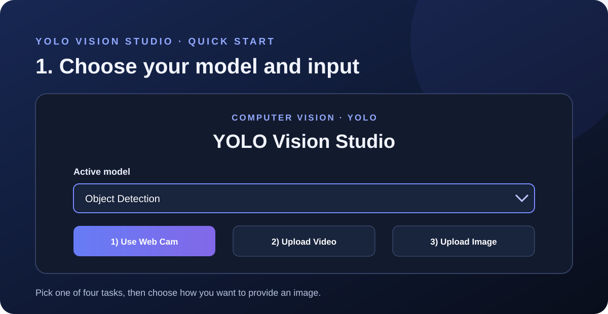

# YOLO Vision Studio

A Flask web app for running four trained Ultralytics YOLO models on images, videos, and live webcam frames. Inference runs on CPU.

**Designed and created by Murtaza Ali**

- Portfolio: [murtazaalikhan.com](https://www.murtazaalikhan.com)
- Kaggle: [murtazakhanpro](https://www.kaggle.com/murtazakhanpro)
- LinkedIn: [murtazaalikhanworld](https://www.linkedin.com/in/murtazaalikhanworld)

## Features

- Object detection, instance segmentation, pose estimation, and oriented bounding boxes (OBB).
- Image and video uploads with annotated results.
- Browser webcam preview with live predictions.
- CPU inference and Docker deployment support.

## Tech stack

- **Language:** Python 3.11
- **Web application:** Flask, HTML, CSS, and JavaScript
- **Computer vision:** Ultralytics YOLO 8.4.153, OpenCV, and NumPy
- **Inference:** PyTorch and TorchVision CPU wheels
- **Production server:** Gunicorn
- **Deployment:** Docker, configured for Hugging Face Spaces
- **Models:** Four supplied `.pt` YOLO weight files

## Project structure

```text
Vision_Studio/
├── app.py                    # Flask routes, UI, uploads, and inference
├── Dockerfile                # Python and system dependency setup
├── README.md                 # Project guide and deployment notes
├── requirements.txt          # Application dependencies and CPU wheel source
├── requirements-cpu.txt      # Requirements entry point for CPU installs
├── object_detection.pt       # Object detection weights
├── segmentaion_model.pt      # Segmentation weights (supplied filename)
├── pose_model.pt             # Pose estimation weights
├── obb.pt                    # Oriented bounding box weights
├── docs/
│   └── images/               # Quick-start illustrations
├── model.ipynb               # Model exploration notebook
├── uploads/                  # Runtime upload directory (not tracked)
└── runs/                     # Runtime prediction output (not tracked)
```

The segmentation filename preserves the supplied spelling. If you rename the file, update `MODEL_FILES` in `app.py` as well.

## Run locally

Use Python 3.11. From the project directory, install the CPU dependencies and start the app:

```bash
python -m pip install -r requirements-cpu.txt
python app.py
```

Open [http://localhost:7860](http://localhost:7860). To run through Gunicorn:

```bash
gunicorn --bind 0.0.0.0:7860 --workers 1 --threads 4 --timeout 0 app:app
```

Choose a model in the app, then select webcam, image, or video input. Webcam access requires a secure browser context such as HTTPS. Uploads are limited to 500 MB. Supported images are JPG, JPEG, PNG, BMP, WEBP, TIF, and TIFF; supported videos are MP4, AVI, MOV, MKV, WEBM, MPEG, and MPG.




## Docker and Hugging Face Spaces

The Dockerfile serves the app on port `7860`. The configured Space is [Murtazakhanpro/Vision_Studio](https://huggingface.co/spaces/Murtazakhanpro/Vision_Studio). Include the application files, docs, and four model weights in the Space repository. Git LFS tracking for `.pt` weights is configured in `.gitattributes`.

CPU video inference may take longer than GPU inference. Uploaded files and generated videos use local runtime storage and can be cleared when the container restarts.

## Copyright and model files

© 2026 Murtaza Ali. All rights reserved.

The model weights are supplied with this project. Confirm their redistribution terms before publishing or redistributing them; this notice does not assert separate licensing rights over third-party model assets.
